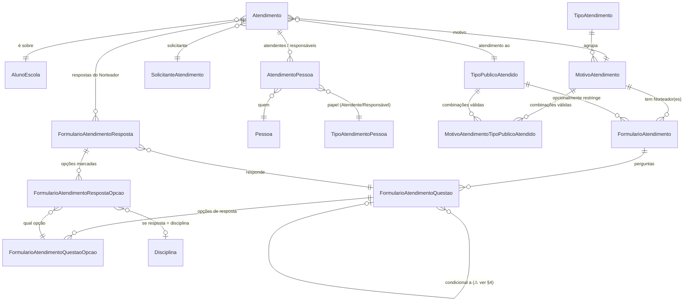

# Entidades — EFC-6546 (Aba Atendimento)

> Levantado em 2026-08-05 lendo o código real em `c:/projects/estrutura-pedagogica/backend/EstruturaPedagogica.Domain/Entities/` (estado atual da branch `feature/EFC-6546`, já com os campos adicionados por T1). Objetivo: explicar o que cada entidade representa, por que existe e quais regras de negócio ela carrega — para entender a lógica do domínio, não só o schema.

---

## 1. Visão geral — três grupos de entidades

O domínio de Atendimento tem três grupos, com propósitos bem diferentes:

1. **O registro em si** — `Atendimento` e `AtendimentoPessoa`: o que aconteceu, quando, com quem.
2. **Os cadastros de referência (o "vocabulário")** — `TipoAtendimento`, `MotivoAtendimento`, `SolicitanteAtendimento`, `TipoPublicoAtendido`, `TipoAtendimentoPessoa`, `MotivoAtendimentoTipoPublicoAtendido`: as opções que preenchem os campos do formulário, mantidas como dados (não enums), configuráveis sem deploy.
3. **O "Norteador" — formulário de perguntas dinâmico** — `FormularioAtendimento`, `FormularioAtendimentoQuestao`, `FormularioAtendimentoQuestaoOpcao`, `FormularioAtendimentoResposta`, `FormularioAtendimentoRespostaOpcao`: um mini "form builder" — perguntas cadastradas por Motivo, e as respostas dadas em cada atendimento específico.



---

## 2. Grupo 1 — O registro do atendimento

### `Atendimento` (Stateful)

**O que é:** o registro central — um atendimento realizado com um aluno e/ou seus responsáveis, em uma data, por um motivo.

**Por que existe:** é o "fato" que a aba lista, edita e exclui. É `Stateful` (não `Base`) porque atendimento tem histórico de auditoria (quem criou, quando, quem alterou) e é excluído por soft-delete (`Ativo = false`, nunca some fisicamente) — condiz com CA-16 ("removido... desaparece da lista", não da base) e com a regra de log de auditoria do card original.

**Campos e a regra de negócio por trás de cada um:**

| Campo | Tipo | Regra de negócio |
|---|---|---|
| `AlunoEscolaId` | FK → `AlunoEscola` | De qual matrícula (aluno + escola + ano) é o atendimento. É por aqui que a lista filtra por aluno e por ano letivo (CA-12/18). |
| `MotivoAtendimentoId` | FK → `MotivoAtendimento` | O motivo escolhido. Determina qual `FormularioAtendimento` (Norteador) carregar (CA-04) e se há envio de e-mail habilitado para esse motivo (`MotivoAtendimento.PossuiEnvioDeEmail`). |
| `SolicitanteAtendimentoId` | FK → `SolicitanteAtendimento` | Quem pediu o atendimento (CA-19/CA-21) — informativo, não altera outras regras. |
| `TipoPublicoAtendidoId` | FK → `TipoPublicoAtendido` | O "Atendimento ao" (Aluno / Responsável / Profissional de Saúde Particular / etc.). É o campo-gatilho de toda a lógica condicional do formulário (CA-03) e das obrigatoriedades de Responsável/Especialista (CA-22, via `PermiteResponsavel`/`PermiteEspecialista` do tipo). |
| `DataAtendimento` | `DateTime` | Não pode ser futura, para nenhuma rede (RN-11). |
| `Observacoes` | `string` | Texto livre — ver §5, ponto ainda em aberto sobre a relação com "Resumo da Conversa" do design. |
| `ProximosPassos` | `string` | Texto livre, opcional — mas se `DataProximosPassos` estiver preenchida, este texto passa a ser obrigatório (RN-10). |
| `DataProximosPassos` | `DateTime?` | Se preenchida: exige `ProximosPassos` não vazio, e não pode ser anterior a `DataAtendimento` (RN-10). Nula = não há follow-up agendado. |
| `Confidencial` | `bool` | Existe na entidade mas **não está coberto por nenhum CA do refinamento atual** — provavelmente controla visibilidade restrita do registro; não usado ainda em nenhum service. Vale confirmar o propósito exato com o time antes de expor no formulário. |
| `Importante` | `bool` | Alimenta o indicador de destaque no card (estrela + fundo âmbar) — CA-23. Desmarcado por padrão. |
| `EnviarEmailResponsavelPedagogico` / `EnviarEmailResponsavelFinanceiro` | `bool` | **Intenção** no momento do salvamento — os dois checkboxes do formulário (CA-06). RP nasce marcado por padrão, RF desmarcado (CA-06). |
| `EmailEnviadoResponsavelPedagogico` / `EmailEnviadoResponsavelFinanceiro` | `bool` | **Auditoria** do que de fato saiu — preenchido pelo `AtendimentoSaveService` (T4) depois que `EmailAtendimentoService` (T3) confirma o envio. É o que o card exibe (CA-26) — deliberadamente separado da intenção, porque a intenção pode não resultar em envio real (ex.: falha do provedor de e-mail). |
| `NomeProfissional` | `string?` | Só usado quando `TipoPublicoAtendido` = Profissional de Saúde Particular (CA-03/CA-24) — campo novo, não existe no legado `portal-atlas`. |
| `FormularioAtendimentoRespostas` | coleção | As respostas do Norteador dadas *neste* atendimento — ver §4. |
| `AtendimentoPessoas` | coleção | As pessoas envolvidas neste atendimento (atendentes e responsáveis) — ver entidade seguinte. |

**Ponto de atenção:** os campos de e-mail de intenção/auditoria foram desenhados em T1 antes da análise do design. O design mostra um único par de checkboxes ligados diretamente à prévia/envio — bate com o modelo, mas também mostra um campo separado "Resumo da Conversa" que é o que efetivamente vai por e-mail, e essa relação com `Observacoes`/o resumo do Norteador ainda não está resolvida (ver §5, item pendente).

### `AtendimentoPessoa` (Stateful)

**O que é:** tabela de associação — liga um `Atendimento` a uma `Pessoa`, com um papel (`TipoAtendimentoPessoa`).

**Por que existe:** um atendimento pode envolver várias pessoas em papéis diferentes — um ou mais atendentes (funcionários que atenderam) e um ou mais responsáveis atendidos (CA-19 do refinamento original: "Atendente(s)"; CA-03: "Responsável(eis) Atendido(s)"). Uma tabela N:N com papel evita ter colunas separadas (`AtendenteId`, `Responsavel1Id`, `Responsavel2Id`...) para uma cardinalidade que é sempre "vários".

**Regra de negócio:** o papel (`TipoAtendimentoPessoaId`) decide COMO a pessoa aparece na tela — como atendente no cabeçalho do card, ou como responsável atendido no formulário. É `Stateful`, então dá para saber quando cada vínculo foi incluído/removido (importante para o card mudar de responsáveis sem perder histórico).

**Pendência real:** conforme identificado na análise do design, hoje **nada persiste ainda o papel "Atendente"** — isso é trabalho de T11/T4, ainda não implementado. A entidade já suporta (é genérica o bastante), só falta o service popular corretamente.

---

## 3. Grupo 2 — Cadastros de referência (o "vocabulário" do formulário)

Todas são `BaseEntity` (não `Stateful`) — são cadastros simples, mantidos por quem administra o Atlas, sem necessidade de auditoria de quem alterou.

### `TipoAtendimento`
Só `Descricao` + lista de `MotivoAtendimento`. É o nível intermediário do formulário: Atendimento ao → **Tipo** → Motivo (CA-02). Sem regra de negócio própria — é um agrupador.

### `MotivoAtendimento`
O nível mais específico do formulário. Além de `Descricao` e o FK para `TipoAtendimento`, carrega:
- `PossuiEnvioDeEmail` (bool) — **flag central**: só motivos com essa flag ativa disparam a lógica de e-mail (CA-06/07/08). Um Motivo sem essa flag nunca mostra os checkboxes de envio.
- `MotivoAtendimentoTipoPublicoAtendidos` — quais "Atendimento ao" são compatíveis com este Motivo (ver entidade de associação abaixo).
- `FormularioAtendimentos` — os Norteadores cadastrados para este Motivo (pode ter mais de um, diferenciado por `TipoPublicoAtendidoId`, ver §4).

### `MotivoAtendimentoTipoPublicoAtendido`
Tabela de associação pura (M:N) entre Motivo e TipoPublicoAtendido. **É o que torna o CA-02 possível de fato:** sem ela, não haveria como saber quais Motivos aparecem para "Atendimento ao = Responsável" vs. "Atendimento ao = Aluno". T2 decidiu filtrar Motivo por Tipo (FK direta) **e** por Publico (via esta tabela) — ver nota de risco já registrada em `tasks_to_ia.md` T2 sobre essa decisão precisar de validação.

### `SolicitanteAtendimento`
Só `Nome` + lista de `Atendimentos`. Representa quem pediu o atendimento (CA-21). É tabela, não enum — por isso a decisão de "6 opções vs. 4 do card vs. 3 do design" é uma questão de **quais linhas existem na tabela**, não de código. Hoje, conforme T2 relatou, não há evidência de que os 6 registros esperados já existam na base.

### `TipoPublicoAtendido`
O "Atendimento ao". Além de `Nome`, carrega três flags que T1 adicionou (replicando o legado `portal-atlas`):
- `PermiteResponsavel` — este tipo aceita/exige responsável atendido?
- `ResponsavelEhOpcional` — se `PermiteResponsavel = true`, o responsável é obrigatório ou opcional? (RN-08)
- `PermiteEspecialista` — este tipo aceita especialista atendido? (RN-09, hoje sem nenhum Tipo ativo que use)

**Por que como flags, e não hardcoded no código:** o mesmo texto "Responsável" pode, em redes diferentes, ter regras diferentes de obrigatoriedade — motivo pelo qual essas regras vivem no cadastro, não em `if`s fixos no service.

### `TipoAtendimentoPessoa`
Só `Descricao` (ex.: "Atendente", "Responsável") + lista de `AtendimentoPessoa`. É o "papel" usado pela tabela de associação do §2. **Não existe como enum no código** (diferente do legado, que tinha `TipoAtendimentoPessoaEnum` fixo) — aqui é dado, então para o código "saber" qual linha é Atendente e qual é Responsável, alguém precisa fixar um Id/Hash conhecido em configuração ou seed, replicando o padrão já usado por `SolicitanteAtendimento`/`TipoAtendimento` neste mesmo repositório (nenhum dos dois tem enum).

---

## 4. Grupo 3 — O Norteador (formulário de perguntas dinâmico)

Esse é o subsistema mais complexo, e o que tem a pendência de schema ainda não resolvida.

### `FormularioAtendimento`
**O que é:** o "Norteador" em si — um roteiro de perguntas associado a um Motivo (e, opcionalmente, restrito a um TipoPublicoAtendido específico via `TipoPublicoAtendidoId` nullable + `AplicavelTodosPublicos`).

**Achado relevante para o design:** esta entidade **já tem um campo `Objetivo` (string)**. Isso resolve a pendência que o plano técnico registrou como risco #13 ("seção Objetivo do design não coberta por nenhum CA, origem do texto incerta") — **o texto "Objetivo" mostrado no mock não precisa de nova coluna: já existe aqui.** T2 precisa apenas expor esse campo em `NorteadorAtendimentoResponse`, e T7 consumir esse valor no toggle "Objetivo" do formulário. Isso deve ser corrigido no plano técnico (ver nota no final deste documento).

**Campos:**
- `MotivoAtendimentoId` (obrigatório) — de qual Motivo é este Norteador.
- `TipoPublicoAtendidoId` (nullable) + `AplicavelTodosPublicos` (bool) — permite um Norteador específico por combinação Motivo+Publico, ou um único Norteador válido para todos os públicos daquele Motivo.
- `Titulo` — cabeçalho exibido no formulário.
- `Objetivo` — o texto descritivo (ver achado acima).
- `FormularioAtendimentoQuestoes` — as perguntas, em ordem.

### `FormularioAtendimentoQuestao`
**O que é:** uma pergunta dentro do Norteador.

**Campos-chave:**
- `TipoQuestaoAtendimento` (enum `TipoQuestaoAtendimentoEnum`) — define como renderizar e validar a resposta. Valores existentes: `TextoApenasSemResposta` (texto informativo, sem campo de resposta), `TextoAberto`, `Binario` (sim/não), `Inteiro`, `Selecao` (única), `SelecaoMultipla`, `SelecaoMultiplaLimitada` (usa `LimiteSelecao`), `SelecaoMultiplaDisciplinasAluno`, `Ocorrencias`, `SelecaoCombo`, `DisciplinasAluno`. Isso cobre (e detalha mais) os tipos de resposta citados no CA-04 do refinamento.
- `Ordem` — ordem de exibição (CA-04: "na ordem cadastrada").
- `LimiteSelecao` (nullable int) — só relevante para `SelecaoMultiplaLimitada`.
- `Opcoes` — lista de `FormularioAtendimentoQuestaoOpcao`, quando o tipo exige seleção.

**✅ Condicionalidade — CORRIGIDO (2026-08-10):**
```csharp
public virtual FormularioAtendimentoQuestaoOpcao FormularioAtendimentoQuestaoOpcaoCondicional { get; set; }
public virtual int? FormularioAtendimentoQuestaoOpcaoCondicionalId { get; set; }
```
O bug era só no **modelo C#** — a propriedade estava tipada como `FormularioAtendimentoQuestao` (auto-referência à pergunta-gatilho), mas a **FK real no banco** (`FK_FormularioAtendimentoQuestao.FormularioAtendimentoQuestaoOpcaoCondicional`, confirmada via `db_map`/`relations.yaml`) **sempre apontou para `FormularioAtendimentoQuestaoOpcao.Id`** — a opção específica, exatamente como CA-04 exige ("a opção que a condiciona") e como o legado `portal-atlas` modela. Não havia gap de schema/SQL nenhum — só o EF Core estava mapeando a relação contra a tabela errada, o que teria causado joins incorretos em runtime.

**Corrigido:** tipo da navegação ajustado para `FormularioAtendimentoQuestaoOpcao`; a lista reversa `QuestoesCondicionadas` (perguntas que dependem desta opção) migrou de `FormularioAtendimentoQuestao` para `FormularioAtendimentoQuestaoOpcao` (onde semanticamente pertence); `PerguntaAtendimentoResponse.HashPerguntaGatilho` renomeado para `HashOpcaoGatilho` (hash da opção específica, não da pergunta) em `FormularioAtendimentoRepository.GetNorteadorPorCombinacao`. Nenhuma migração SQL foi necessária. Isso desbloqueia a implementação fiel de CA-04 em T4/T7 — o frontend só precisa checar se a opção com esse hash está entre as respostas já dadas, sem precisar saber separadamente qual é a pergunta-gatilho.

### `FormularioAtendimentoQuestaoOpcao`
**O que é:** uma opção de resposta de uma pergunta de seleção.
- `Texto`, `Ordem` — o que exibir e em que ordem.
- `Unica` (bool) — provavelmente marca uma opção como mutuamente exclusiva dentro de uma pergunta de seleção múltipla (ex.: "Nenhuma das anteriores"); não há uso ainda em código, então o comportamento exato depende de quem implementar T7 confirmar a intenção.
- `TextoExplicativoSelecionado` — texto adicional exibido quando esta opção específica é marcada (ex.: uma nota de contexto). Não coberto por nenhum CA — feature "bônus" já modelada no schema.

### `FormularioAtendimentoResposta` (Stateful)
**O que é:** a resposta dada a uma pergunta, **dentro de um Atendimento específico**. Liga `Atendimento` + `FormularioAtendimentoQuestao` a um valor.

**Por que quatro campos de resposta diferentes** (`RespostaBit`, `RespostaTexto`, `RespostaInteiro`, `RespostaDataHora`) — só um é preenchido por vez, dependendo do `TipoQuestaoAtendimento` da pergunta respondida (`Binario`→`RespostaBit`, `TextoAberto`→`RespostaTexto`, `Inteiro`→`RespostaInteiro`, etc.). Isso é o padrão "wide table" para respostas polimórficas — evita uma tabela por tipo de pergunta, ao custo de ter colunas nulas na maioria dos registros. É `Stateful` porque respostas também têm auditoria (quando foram dadas/alteradas).

Para perguntas de **seleção** (única, múltipla, disciplinas, etc.), nenhum desses quatro campos é usado — a resposta vive em `FormularioAtendimentoRespostaOpcoes`.

### `FormularioAtendimentoRespostaOpcao` (Stateful)
**O que é:** quando a resposta é uma ou mais opções marcadas, cada opção marcada gera uma linha aqui, ligando a `FormularioAtendimentoResposta` e à `FormularioAtendimentoQuestaoOpcao` escolhida.

**Campo extra interessante:** `RespostaDisciplinaAluno` (FK nullable para `Disciplina`) — usado especificamente quando o tipo da pergunta é `SelecaoMultiplaDisciplinasAluno`/`DisciplinasAluno`: em vez de escolher entre as `Opcoes` cadastradas do Norteador, a resposta referencia diretamente uma disciplina real do currículo do aluno. Isso é o que viabiliza o "select de disciplinas" mostrado no design (`NQSelect` com `DISCIPLINAS_LIST`) sem precisar cadastrar cada disciplina como `FormularioAtendimentoQuestaoOpcao`.

---

## 5. Como as peças se conectam no fluxo real

1. Usuário abre "Novo Atendimento" → escolhe **Atendimento ao** (`TipoPublicoAtendido`) → isso filtra os **Tipos** (`TipoAtendimento`) disponíveis (via `MotivoAtendimentoTipoPublicoAtendido`, indiretamente) → escolhe **Tipo** → filtra os **Motivos** (`MotivoAtendimento.TipoAtendimentoId` + a tabela de associação) → escolhe **Motivo**.
2. Com Atendimento ao + Motivo definidos, o sistema busca o `FormularioAtendimento` correspondente (Norteador) — usa `TipoPublicoAtendidoId` se houver um específico, senão o que tem `AplicavelTodosPublicos = true`.
3. Renderiza as `FormularioAtendimentoQuestoes` em `Ordem`, escondendo as que são condicionais até a opção-gatilho específica (`HashOpcaoGatilho`, ver §4) ser selecionada em alguma resposta anterior.
4. Ao salvar: cria o `Atendimento`, mais uma `FormularioAtendimentoResposta` por pergunta respondida (mais `FormularioAtendimentoRespostaOpcao` para as de seleção), mais `AtendimentoPessoa` para cada atendente/responsável selecionado, decide o envio de e-mail (`EmailAtendimentoService`, T3) com base nos dois checkboxes e grava a intenção/auditoria em `Atendimento`.
5. Ao exibir o card: usa os FKs diretos (`MotivoAtendimento`, `SolicitanteAtendimento`, `TipoPublicoAtendido`) para o cabeçalho, e as `FormularioAtendimentoRespostas` para montar o painel "Norteadores" (e, possivelmente, gerar o resumo automático do CA-04b — ainda sem lógica implementada).

---

## Achados que exigem atualizar o plano técnico

- **Risco #13 do `EFC-6546.tech.md` está parcialmente resolvido:** `FormularioAtendimento.Objetivo` já existe no schema — não é preciso criar coluna nova em `MotivoAtendimento`. Só falta expor no DTO (T2) e consumir no frontend (T7).
- **A pendência do §4 (condicionalidade por opção, não por pergunta) continua sem decisão** — nenhuma informação nova aqui além da já registrada em `tasks_to_ia.md` (T2/T4/T11).
- **`Confidencial`** é um campo existente em `Atendimento` sem nenhum CA associado — vale perguntar ao time se é uma feature esquecida do refinamento ou algo a ignorar por ora.
- **`FormularioAtendimentoQuestaoOpcao.Unica` e `TextoExplicativoSelecionado`** são capacidades já modeladas no schema sem CA correspondente — não bloqueiam nada, mas podem ser usadas se surgir a necessidade (ex.: opção "Nenhuma das anteriores" ou textos de apoio contextual).
